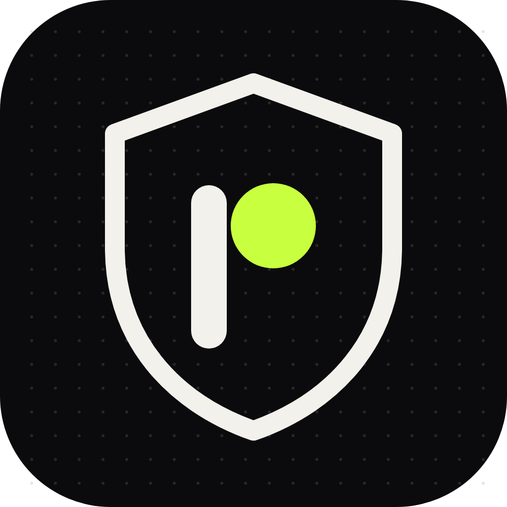

# Pivyon Shield



By [Pivyon](https://pivyon.com).

**Keep your Claude Code sessions and development safe from malware, without
thinking about it. Keep building: zero setup required, free forever.**

Claude installs packages constantly. Pivyon Shield checks every single one
before it runs, and blocks the fake and malicious ones that could compromise
your code, your project and your machine.

```
/plugin marketplace add bhardwajnishant333-ctrl/pivyon-shield
/plugin install pivyon-shield@pivyon
```

> **A real catch.** We asked Claude to add two dependencies to a project. One
> was `lodahs`, one letter off from `lodash`, and a real package that npm had
> removed for malicious code. Claude didn't notice. Pivyon Shield blocked the
> edit before the file changed.

- 🚫 **Blocks** packages that don't exist (hallucinated names), known malware
  and registry takedowns.
- ✋ **Asks you** about lookalikes (`expresss`, `reqeusts`), brand-new packages,
  and releases less than 24 hours old, when hijacked releases usually hit.
- 🩹 **Tells Claude the safe version** when a dependency has known
  vulnerabilities.

No account, no API key, no telemetry, nothing else to install. It stays silent
on ordinary commands and takes under a second on installs.

Or, on Claude Code 2.1.275 or later:

```
/plugin install pivyon-shield --marketplace bhardwajnishant333-ctrl/pivyon-shield
```

## Why this exists

Coding agents install packages constantly, and language models invent
package names that sound right but don't exist. Attackers register those
invented names and publish malware under them, a practice called
**slopsquatting**. Typosquats (`lodahs`, `reqeusts`, `crossenv`) and hijacked
releases of popular packages (the 2025 `chalk`/`debug` compromise, the
Shai-Hulud npm worm) make it worse. An agent that runs `npm install` on its
own can pull any of these straight into your machine and CI.

Pivyon Shield sits at that boundary. It's a `PreToolUse` hook, so it runs
**before** the command does.

## What it catches

| Signal | Decision |
|---|---|
| Package does not exist on the public registry (hallucinated) | **Block**, and suggest the popular package it resembles |
| Listed in the OpenSSF malicious-packages feed (OSV `MAL-` advisories) | **Block** |
| Removed by npm security (`0.0.1-security` placeholder) or quarantined by PyPI | **Block** |
| Your project's deny list | **Block** |
| Lookalike of a top package (`expresss`, `python-dateutils`, `lodash-utils`, separator tricks) | **Ask you** |
| Non-popular package first published less than 30 days ago | **Ask you** |
| The version being installed was published less than 24 h ago (cooldown against hijacked releases) | **Ask you** |
| Known vulnerability at or above your threshold (default: critical) | **Ask you**, with the fixed version |
| Other known vulnerabilities, deprecated or yanked versions, install scripts, very low adoption, a missing requested version | **Allow**, and tell Claude, with the fix version |
| Registry unreachable | **Allow** silently (fail-open, so the guard never breaks your work offline) |

"Block" denies the tool call and tells Claude why and what to do instead.
"Ask you" shows a permission prompt with the evidence.

### Coverage

| Ecosystem | Commands | Manifest edits |
|---|---|---|
| npm | `npm`/`pnpm`/`yarn`/`bun` add and install, `npx`, `pnpx`, `bunx`, `pnpm dlx`, `yarn dlx`, `npm exec`, `npm create`/`init` (resolves `create-*`) | `package.json` |
| PyPI | `pip`/`pip3`/`python -m pip`, `uv add`/`uv pip install`/`uv tool`, `uvx`, `pipx`, `poetry add`, `pdm add`, `rye add`, `-r requirements.txt` (followed recursively) | `requirements*.txt`, `pyproject.toml` (PEP 621, dependency groups, Poetry) |
| crates.io | `cargo add`, `cargo install`, `cargo binstall` | `Cargo.toml` |
| Go | `go get`, `go install`, `go run pkg@version` | `go.mod` |
| RubyGems | `gem install`, `bundle add` | `Gemfile` |
| Packagist | `composer require`, `composer create-project` | `composer.json` |

It understands compound shell lines (`&&`, `;`, pipes, `$(…)`), `sudo` and
`env` prefixes, and ignores heredoc bodies, quoted strings, local paths, git
URLs and tarballs. It also respects private registries: `--registry` and
`--index-url` flags, `GOPRIVATE`, and the private-registry settings below. It
never reads `.npmrc`, `pip.conf` or index-URL variables, because those hold
auth tokens.
Edits to manifests are diffed, so only the dependencies an edit adds or
changes get checked.

## Skills

- **`/pivyon-shield:audit`** scans every lockfile in the project
  (package-lock, yarn, pnpm, bun, requirements, poetry, uv, pdm, Pipfile,
  Cargo, go.mod, Gemfile, composer) against OSV.dev in one batch. Claude then
  triages the results (malware first, then direct critical/high), applies the
  smallest safe upgrade per ecosystem, re-scans, and runs your tests.
- **`/pivyon-shield:vet npm:fastify npm:express`** runs due diligence before
  you pick a dependency: whether it exists, popularity rank, age, release
  cadence, license, install scripts, vulnerabilities and malware history.
  Claude also uses it on its own before recommending a library.

Both are plain scripts you can run yourself:

```bash
python3 scripts/shield.py audit . --fail-on high   # CI gate, exit 1 on findings
python3 scripts/shield.py vet pypi:httpx pypi:requests
python3 scripts/shield.py check "npm install expresss"   # dry-run the hook
```

## Configuration

Optional. Put this in `.pivyon-shield.json` at the project root, or in
`~/.config/pivyon-shield/config.json` for every project:

```json
{
  "mode": "enforce",
  "cooldown_hours": 24,
  "new_package_days": 30,
  "block_vulnerable": "critical",
  "allow": ["npm:my-internal-tool", "PyPI:our-private-lib"],
  "deny": ["npm:event-stream"],
  "private_npm_scopes": ["@mycompany"],
  "private_npm_registry": false,
  "private_pypi_index": false
}
```

- `mode`: `enforce` (default) blocks and asks. `warn` never blocks and only
  tells Claude. `off` disables the plugin.
- `cooldown_hours`: ask before installing a release younger than this. Set
  it to `0` to turn the cooldown off.
- `block_vulnerable`: the lowest known-vulnerability severity that triggers a
  prompt. One of `critical`, `high`, `medium`, `low` or `never`.
- `private_npm_scopes`, `private_npm_registry`, `private_pypi_index`: tell it
  which packages come from your company's private registry, so a name that
  isn't on the public registry gets a warning about dependency confusion
  instead of a block.

Every setting can also be set through an environment variable:
`PIVYON_SHIELD_MODE`, `PIVYON_SHIELD_COOLDOWN_HOURS`,
`PIVYON_SHIELD_NEW_PACKAGE_DAYS`, `PIVYON_SHIELD_BLOCK_VULNERABLE`, and
`PIVYON_SHIELD_ALLOW` / `PIVYON_SHIELD_DENY` (comma-separated).

## Privacy and cost

- **Data sent:** only package names and versions, to the same public
  registries your package manager already contacts (registry.npmjs.org,
  pypi.org, crates.io, proxy.golang.org, rubygems.org, repo.packagist.org),
  plus api.osv.dev and api.npmjs.org (download counts). Nothing else leaves
  your machine. No source code, no file contents, no telemetry.
- **Cost:** none. All of these APIs are free and need no key.
- **Speed:** ordinary commands are filtered out in a few milliseconds without
  starting Python. Installs are checked in parallel, typically in under a
  second, and cached for an hour in `~/.cache/pivyon-shield`.
- **Fail-open:** if a registry can't be reached, or anything unexpected
  happens, the tool call goes ahead as if the plugin weren't there.

## Requirements

Python 3.8 or later on `PATH` as `python3`, `python` or `py -3`. Claude Code
on Windows runs hooks in Git Bash, which the launcher supports. No pip
installs.

## Limitations

- Checks are heuristics on top of authoritative data. A brand-new malicious
  package that isn't yet in OSV and doesn't look like a popular name will
  only trigger the "new package" prompt.
- Bare `npm install` / `pip install -r` with no manifest edit in this session
  isn't diffed. Run `/pivyon-shield:audit` for whole-project coverage.
- Transitive dependencies are covered by the audit, not by the install-time
  hook.

## Development

```bash
python3 -m unittest discover -s tests   # 43 offline tests, real OSV records as fixtures
claude plugin validate .
```

## Data sources and credits

- [OSV.dev](https://osv.dev) (Google, Apache-2.0 API), which aggregates GitHub
  Advisories, PyPA, RustSec, the Go vulnerability database, RubySec and the
  [OpenSSF malicious-packages](https://github.com/ossf/malicious-packages)
  feed.
- Popular-package lists for lookalike detection:
  [wooorm/npm-high-impact](https://github.com/wooorm/npm-high-impact) (MIT),
  [hugovk/top-pypi-packages](https://github.com/hugovk/top-pypi-packages),
  the crates.io API, and rubygems.org stats. Snapshots are in `data/`.

License: MIT.
